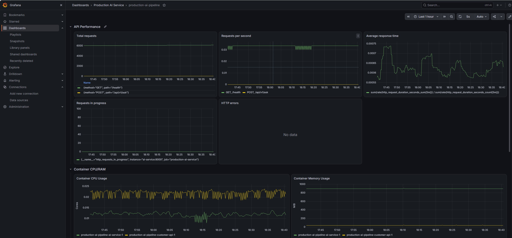

# Production AI Service & MLOps

A production-oriented multi-agent AI service built with **Python, FastAPI, LangGraph, Docker, Prometheus, and Grafana**.

This project is the third stage of a GenAI engineering project series, evolving an enterprise RAG assistant into a containerized, monitored, and production-oriented AI service.

## Project Evolution

This project builds upon two previous projects:

| Project | Focus |
|---|---|
| [Enterprise RAG Assistant](https://github.com/milsever/enterprise-rag-assistant) | Enterprise knowledge retrieval using RAG |
| [Agentic AI Workflow](https://github.com/milsever/agentic-ai-workflow) | Multi-agent orchestration and tool calling |
| **Production AI Service & MLOps** | API integration, containerization, monitoring, and CI/CD |

The third project focuses on taking the multi-agent architecture further towards production deployment and operational reliability.

## Architecture

The system uses a LangGraph orchestrator to route requests to specialized agents:

- **RAG Specialist:** Retrieves information from enterprise documents using ChromaDB and hybrid retrieval.
- **Application Specialist:** Queries a mock customer application API.
- **Orchestrator:** Coordinates the specialists and generates the final response.

```text
                  User
                   |
             FastAPI / CLI
                   |
             LangGraph
              Orchestrator
              /         \
         RAG Agent   Application Agent
             |             |
          ChromaDB     Customer API

       Prometheus + Grafana
          Monitoring
```

## Technology Stack

- **Language:** Python
- **AI & Orchestration:** LangChain, LangGraph
- **LLM Providers:** Ollama, OpenAI, Azure OpenAI
- **Retrieval:** ChromaDB, BM25, Sentence Transformers
- **API:** FastAPI, Uvicorn
- **Containerization:** Docker, Docker Compose
- **Monitoring:** Prometheus, Grafana, cAdvisor, Windows Exporter
- **Testing & CI:** pytest, GitHub Actions

## Features

- Multi-agent orchestration with specialized RAG and application agents.
- REST API with request validation and health checks.
- Structured JSON logging and request ID tracking.
- Prometheus metrics for API performance and request monitoring.
- Container and host resource monitoring, including CPU, RAM, GPU utilization, and VRAM.
- Grafana dashboards with automatic provisioning.
- Docker Compose-based multi-service deployment.
- Automated testing and Docker build validation through GitHub Actions.

### Monitoring Dashboard



## API Endpoints

| Method | Endpoint | Description |
|---|---|---|
| GET | `/health` | Service health check |
| POST | `/api/v1/ask` | Submit a question |
| GET | `/metrics` | Prometheus metrics |
| GET | `/docs` | Interactive API documentation |

Example request:

```json
{
  "question": "Bankaların çağrı merkezleri için yıllık ulaşılabilirlik seviyesi en az yüzde kaç olmalıdır? Bu oran nasıl hesaplanır?"
}
```

## Getting Started

### Prerequisites

- Docker Desktop and Docker Compose
- Ollama with the configured model, or OpenAI/Azure OpenAI credentials
- Existing ChromaDB index under `data/chroma/`

### Configuration

Create a local environment file:

```powershell
Copy-Item .env.example .env
```

Configure the LLM provider and required environment variables.

For the default Ollama configuration:

```powershell
ollama pull gpt-oss:20b
```

Create the external Hugging Face cache volume:

```powershell
docker volume create production-ai-hf-cache
```

### Start Services

```powershell
docker compose up --build -d
```

| Service | URL |
|---|---|
| AI Service API | http://localhost:8000 |
| API Documentation | http://localhost:8000/docs |
| Prometheus | http://localhost:9090 |
| Grafana | http://localhost:3000 |
| cAdvisor | http://localhost:8081 |

The CLI interface from the [Agentic AI Workflow](https://github.com/milsever/agentic-ai-workflow) project is also retained.

## Run Tests

Install development dependencies and run the test suite:

```powershell
pip install -r requirements-dev.txt
python -m pytest
```

The test suite uses mocks where appropriate and does not require live LLM inference for the covered workflows.

## Project Structure

```text
.
├── src/rag_assistant/       # Agents, API, retrieval and tools
├── tests/                   # Automated tests
├── monitoring/
│   ├── prometheus/          # Prometheus configuration
│   └── grafana/             # Dashboards and provisioning
├── data/
│   ├── documents/           # Local source documents
│   └── chroma/              # Local vector database
├── assets/                  # Project images
├── .github/workflows/       # CI workflows
├── Dockerfile
├── compose.yaml
├── requirements.txt
└── requirements-dev.txt
```

## Notes

- The customer application API uses mock data for demonstration purposes.
- Source documents and the ChromaDB index are not included in the repository.
- With the default Docker Desktop configuration, Ollama inference runs on the Windows host.
